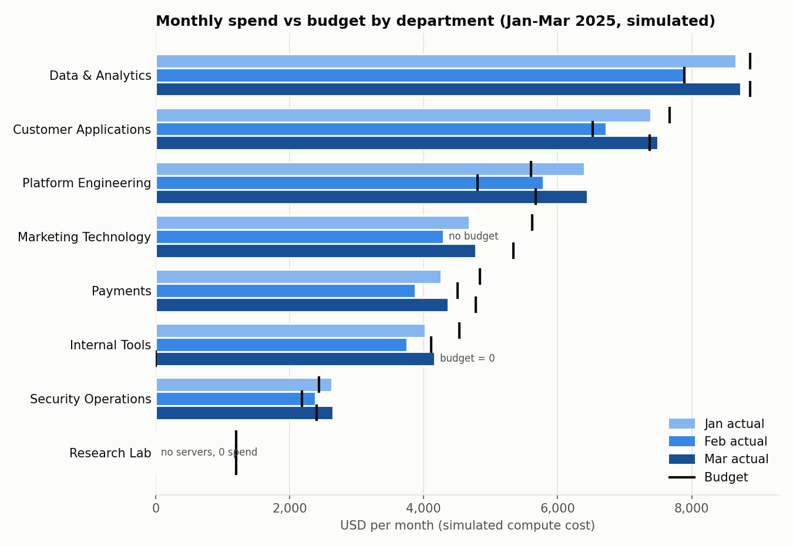
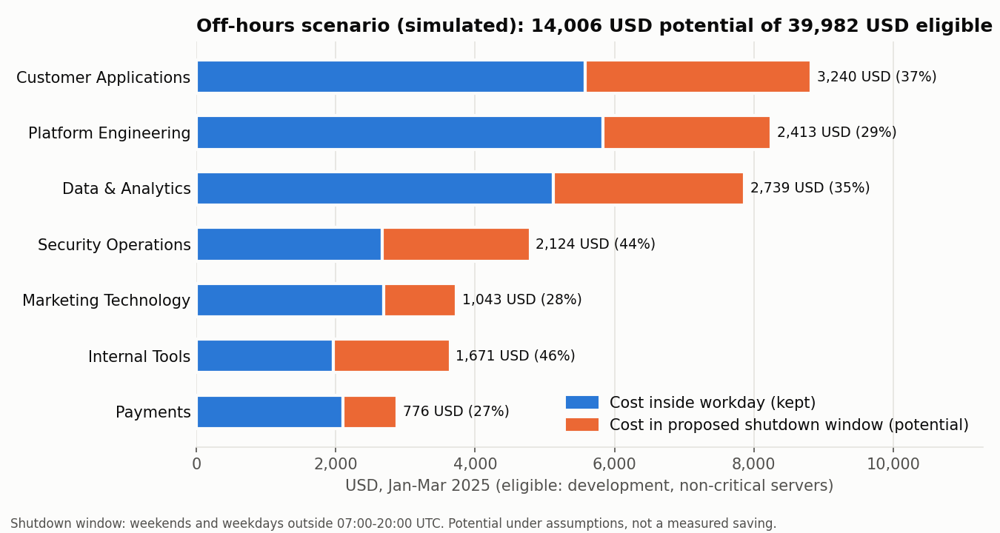

# Cloud Cost & Utilization Analytics — SQL Case Study

A PostgreSQL case study on simulated server data. It answers one question:

> Which areas concentrate server spend, where is capacity under-used, and how much could change if development servers followed an operating schedule?

**Everything in this repository is simulated.** Servers, departments, power events, CPU and memory measurements, budgets and hourly prices are fictitious and were generated by [`generator/generate_data.py`](generator/generate_data.py). Region and instance-type names are invented. Nothing here describes a real company, a real cloud bill or work done for any cloud provider.

The project grew out of a small exercise based on DataLemur's [Server Utilization Time](https://datalemur.com/questions/total-utilization-time) problem, kept unchanged in [`examples/server_uptime_basics/`](examples/server_uptime_basics/).

## Data and model

Six source tables in PostgreSQL ([`sql/01_schema.sql`](sql/01_schema.sql)):

| Table | One row per | Key integrity rules |
|---|---|---|
| `departments` | business area / cost center | unique name and cost center |
| `servers` | server | FK to department; environment and criticality |
| `server_events` | start or stop event | unique `(server_id, event_time)` rejects duplicates and ties |
| `server_metrics` | server × UTC hour | CPU / memory 0–100, hour-aligned |
| `pricing` | tariff version per type and region | exclusion constraint: no overlapping validity; changes at 00:00 UTC |
| `budgets` | department × month | amount ≥ 0; zero budget ≠ missing budget |

Diagram and dictionary: [`docs/data_model.md`](docs/data_model.md). Calculation rules, boundary handling and parameters: [`docs/methodology.md`](docs/methodology.md).

Two dataset sizes are generated with fixed seed `20250101` for `[2025-01-01, 2025-04-01)` UTC:

| Size | Servers | Events | Hourly metrics | Server-hours after transform |
|---|---:|---:|---:|---:|
| `small` | 24 | 1,764 | 32,253 | 32,916 |
| `portfolio` | 500 | 33,526 | 679,122 | 695,384 |

Counts are the rows actually loaded. They match the generator manifests ([`results/portfolio/run_summary.json`](results/portfolio/run_summary.json)).

### How running time and cost are computed

1. **Validate events.** Events are ordered with `LAG`/`LEAD` per server. A start is paired only with the stop that immediately follows it. Ambiguous sequences (start→start, orphan stops, open sessions) are excluded and counted, never guessed: 22 of 33,526 portfolio events.
2. **Clip and split.** Sessions are rebuilt from the full event extract, clipped to the half-open analysis period, and split into UTC clock hours ([`sql/02_transform.sql`](sql/02_transform.sql)). Sessions that cross midnight, month ends or the mid-February tariff change are allocated correctly.
3. **Price each hour.** Each server-hour is priced with the tariff valid at that hour ([`v_hourly_cost`](sql/03_views.sql)). Compute time only: no storage, transfer, taxes or discounts.
4. **Treat missing metrics as unknown.** Hourly metrics are joined only to hours with reconstructed running time. Missing samples lower coverage and are never treated as 0 % CPU.

## Six analyses

| # | Question | SQL |
|---|---|---|
| 1 | Running time per server and month (every server × month, zeros kept) | [`01_uptime_by_server_month.sql`](sql/analysis/01_uptime_by_server_month.sql) |
| 2 | Monthly cost by department, region and environment | [`02_cost_by_department_region_environment.sql`](sql/analysis/02_cost_by_department_region_environment.sql) |
| 3 | Spend vs budget, keeping areas without spend and separating zero from missing budget | [`03_budget_vs_actual.sql`](sql/analysis/03_budget_vs_actual.sql) |
| 4 | Low utilization observed during the 90-day period (CPU, memory, observed running time, time-based coverage) | [`04_low_utilization.sql`](sql/analysis/04_low_utilization.sql) |
| 5 | Month-over-month change, ranking and cumulative share | [`05_spend_trend_concentration.sql`](sql/analysis/05_spend_trend_concentration.sql) |
| 6 | Potential savings from an off-hours shutdown schedule | [`06_offhours_savings_scenario.sql`](sql/analysis/06_offhours_savings_scenario.sql) |

Each analysis is a view. Exported results, rounded only for presentation, are in [`results/portfolio/`](results/portfolio/) and [`results/small/`](results/small/).

## Findings (portfolio run, simulated data)

Total simulated compute cost for the 90 days: **111,407.98 USD**. Production accounts for 61.1 % of it and development for 38.9 %.

**1. Two areas are over budget in all three months, and budget coverage has gaps.**
- Platform Engineering spent +14.2 %, +20.5 % and +13.6 % above budget in January, February and March.
- Security Operations spent +7.8 %, +9.5 % and +10.4 % above budget in the same months.
- Three cases would be lost or mislabelled by an inner join or by a percentage-only report:
  - Internal Tools had an explicit **zero** budget in March but spent 4,163.88 USD.
  - Marketing Technology spent 4,292.00 USD in February with **no** budget row.
  - Research Lab holds 1,200 USD a month of budget and owns no servers.



**2. About a fifth of spend sits on servers with low utilization observed during the 90-day period.**
- 126 of 500 servers meet all low-utilization thresholds. They cost 23,938.84 USD, 21.5 % of total compute. The thresholds:
  - average CPU ≤ 10 %;
  - p95 of hourly CPU ≤ 30 %;
  - average memory ≤ 40 %;
  - at least 168 hours of *observed running time* (summed in seconds, not counted in hour bins);
  - at least 80 % of running time observed.
- 28 of them are production servers and 29 are flagged critical, so this is a list for rightsizing review, not for shutdown.
- 54 development servers could not be judged. All of them have less than 168 observed running hours; none failed on coverage alone. Another 8 servers never ran.

Observed time is measured in seconds because a clock-hour bin can contain a single running second. Counting bins instead would classify three more servers (ids 135, 375, 478, each with 170–182 observed bins but 126–141 observed running hours). [`docs/methodology.md`](docs/methodology.md#units-in-analysis-4) defines each column.

**3. The off-hours scenario puts about a third of eligible cost in scope.**
- 270 development, non-critical servers are eligible.
- Under the reference schedule (on Monday–Friday 07:00–20:00 UTC, off otherwise), 71,819 of their 219,212 running hours fall in the shutdown window. That time costs **14,006.15 USD of 39,982.44 USD eligible (35.0 %)**, or 12.6 % of total compute cost.



### Implications and limits

- **Concentration and calendar effects.** The top three departments account for about 59 % of spend in every month (analysis 5). Among the seven departments with spend, February is 6.9–9.6 % below January. February's shorter length (28 days, 672 vs 744 hours, −9.7 %) is consistent with that drop, but the data alone do not show it is the only cause. Month-over-month changes are worth normalizing per day before reading them as changes in behavior.
- **The savings figure is an upper bound.** It assumes all running time in the window could stop. It ignores night jobs, users in other time zones, restart costs and dependencies, and it has not been achieved. Any schedule change needs an operational review first.
- **The findings depend on the simulator.** They depend on its parameters: profile mix, share of forgotten sessions, budget rule. They show the method working end to end. They are not benchmarks for real fleets.
- **Simplifications.** Constant server attributes, UTC-only schedules, compute-only billing, and conservative exclusion of ambiguous events (this under-counts rather than invents running time).

## Query performance (measured)

Three representative queries were compared on the portfolio database: a baseline and an optimized version of each, with identical results checked by `EXCEPT ALL` in both directions. Each variant had 7 warm-cache runs of `EXPLAIN (ANALYZE, BUFFERS, FORMAT JSON)`, on PostgreSQL 17.11 in Docker Desktop (8 CPUs, 3.8 GiB).

| Query | Change | Median ms (baseline → optimized) | Buffers |
|---|---|---|---|
| Q1 one server, one week of metrics | sargable half-open range instead of `::date` cast | 2.90 → 0.31 | 2,143 → 172 |
| Q2 monthly cost with four-table join | pre-aggregate to server × day before joining (valid because tariffs change at midnight) | 363.91 → 117.57 | 4,739 → 4,535 |
| Q3 dev utilization profile for March | range predicate, then a 24 KB BRIN index | 60.47 → 32.18 → 28.90 | 5,116 → 5,042 → 1,850 |

- **Estimated cost and measured time can disagree.** The planner estimated Q2's optimized plan as *more* expensive, yet its measured median was about 3× lower. One visible difference is that the baseline's sort ran as an external merge on temporary files and the optimized plan's did not. The plans do not allow the time saved to be attributed to that alone.
- **An index can save buffers without saving much time.** In Q3 the BRIN index cut buffers by about 63 % but the median time by only about 10 %, with a warm cache.

These measurements were taken before the analysis 4 correction. That correction left the benchmark queries, data, schema and indexes unchanged, so the benchmark was not repeated, and the results are preserved evidence from that run (see [provenance](benchmark/README.md)).

Full protocol, plans and discussion: [`benchmark/README.md`](benchmark/README.md).


## Tests and evidence

- **Automated tests** ([`tests/run_tests.py`](tests/run_tests.py)): 11 SQL test files, 136 assertions, in two suites. Each suite has its own fixture, its own test database and hand-computed expected values:
  - **core** ([`fixture_core.sql`](tests/fixtures/fixture_core.sql)), 8 files.
  - **partial_hours** ([`fixture_partial_hours.sql`](tests/fixtures/fixture_partial_hours.sql)), 3 files, checking the units of analysis 4:
    - many observed bins with little running time;
    - coverage by time (8 / 7,208 s) vs by sample count (8 / 10);
    - the exact observed-time minimum and one second below it.
  - The defective fixture data never touches the analysis databases.
  - Coverage: normal and multiple sessions; month-end and tariff-change splits; servers and areas without spend; zero vs missing budget; missing metrics; duplicates, invalid sequences and incomplete sessions; overlapping and missing tariffs; conservation of totals; no cost duplication after joins; savings between 0 and eligible cost.
  - A failed assertion makes the script exit non-zero, and a built-in negative control proves this.
  - [`tests_mutation_check.log`](docs/evidence/tests_mutation_check.log): the core tests fail when the tariff join is broken on purpose.
  - [`tests_partial_hours_old_logic.log`](docs/evidence/tests_partial_hours_old_logic.log): all three partial-hour files fail against the earlier bin-count version of analysis 4.
- **Quality gate** ([`sql/04_quality_gate.sql`](sql/04_quality_gate.sql)): 13 invariants checked on every pipeline run, including no pricing gaps, conserved totals and complete calendar grids.
- **Evidence:** [`docs/evidence/`](docs/evidence/) holds the logs of:
  - the test run, both pipeline runs and the benchmark (the benchmark log is from the earlier run, see above);
  - the clean-shell check that `config.example.env` reaches Python ([`config_env_check.log`](docs/evidence/config_env_check.log)).

  Each `run_summary.json` records the PostgreSQL version, generated vs loaded counts, data-quality counts and a SHA-256 fingerprint of the SQL and Python code that produced it.

## Reproduce

Requirements: PostgreSQL 14 or later with the `btree_gist` extension available (tested on 17.11), Python 3.9+ (tested with 3.13), and matplotlib for the figures only. The analysis scripts use the Python standard library and call `psql`.

Connection settings come only from exported environment variables. No password is stored in the project; use `~/.pgpass` or your own environment.

1. Copy [`config.example.env`](config.example.env) to `.env` (ignored by git).
2. Choose option A (local psql with `PGHOST`/`PGPORT`/`PGUSER`) or option B (psql inside a Docker container).
3. Load it with `source .env` in the shell that runs the scripts. Every line uses `export`, so Python and psql inherit the values.

```bash
cp config.example.env .env   # then edit .env
source .env

python3 tests/run_tests.py                        # cloud_cost_utilization_test and _test_partial_hours
python3 scripts/run_pipeline.py --size small      # ~10 s, cloud_cost_utilization_small
python3 scripts/run_pipeline.py --size portfolio  # ~40 s, cloud_cost_utilization_portfolio
python3 benchmark/run_benchmark.py                # ~3 min, needs the portfolio database
python3 scripts/make_figures.py
```

Each script drops and recreates **only** its own dedicated databases (`<prefix>_small`, `_portfolio`, `_test`, `_test_partial_hours`). The generated CSV files go to `data/generated/` and are not versioned, because they are regenerated identically from the seed.

## Repository structure

```
sql/01_schema.sql            six tables, constraints, analysis_config
sql/02_transform.sql         event validation, sessions, hourly split
sql/03_views.sql             cost model view and data-quality views
sql/04_quality_gate.sql      invariants checked on every run
sql/05_indexes.sql           index kept after the benchmark (BRIN)
sql/analysis/                the six analyses (views)
generator/generate_data.py   deterministic data simulator
scripts/run_pipeline.py      end-to-end run for small | portfolio
scripts/pgutil.py            psql helper (environment-based connection)
scripts/make_figures.py      the three figures, from exported CSVs
tests/                       two fixtures, SQL tests, test runner
benchmark/                   query variants, runner, plans, results
results/                     aggregated CSV results and run summaries
figures/                     README figures
docs/                        data model, methodology, evidence logs
examples/server_uptime_basics/  the original DataLemur-based exercise
```

## Acknowledgement

The starting point is the "Server Utilization Time" question from [DataLemur](https://datalemur.com/questions/total-utilization-time), solved as an educational exercise in [`examples/server_uptime_basics/`](examples/server_uptime_basics/). The data model, simulation and analyses in this repository are an independent extension built on simulated data.
