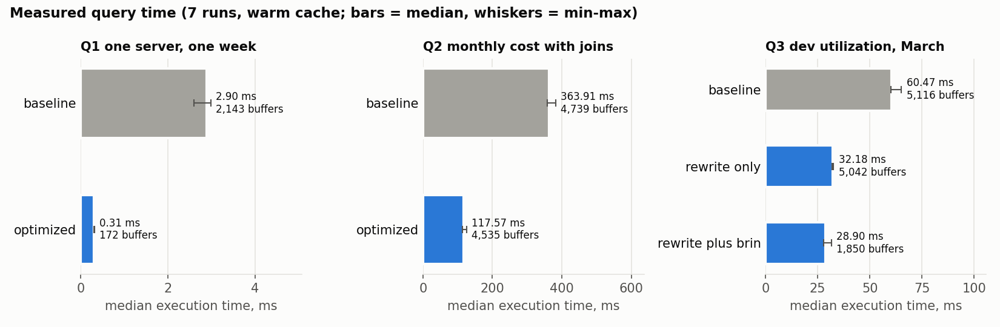

# Query optimization benchmark

Measured on the `portfolio` database (500 servers, 679,122 metric rows, 695,384 server-hour rows). Timings are real measurements from one local lab run. They depend on hardware and cache state and should not be read as a general speed-up promise.

**Provenance.** All files in `results/` and [`docs/evidence/benchmark.log`](../docs/evidence/benchmark.log) come from the benchmark run of 2026-10-29. Afterwards, the definition of observed time in analysis 4 was corrected. That correction did not touch any of the inputs to this benchmark:
- the benchmark queries;
- the generated data (identical SHA-256 per file);
- the schema;
- the indexes.

The benchmark was therefore **not repeated**. The figures below are preserved evidence from that earlier run, not new measurements.

## Environment

PostgreSQL 17.11 (aarch64, Alpine image) running under Docker Desktop with 8 CPUs and 3.8 GiB of memory. Server settings were left at the image defaults: `shared_buffers` 160 MB, `work_mem` 4 MB, `max_parallel_workers_per_gather` 2, `jit` on (it never triggered for these queries). Full details: [`results/environment.json`](results/environment.json).

## Protocol ([`run_benchmark.py`](run_benchmark.py))

1. **Phase A.** Drop the optimization index (if it exists), then `VACUUM ANALYZE`. Run every variant that does not need it.
2. **Phase B.** Create the BRIN index, recording its build time and size, then `ANALYZE`. Run the variant that uses it.
3. **Equivalence.** Before measuring, each variant is compared with its baseline using `EXCEPT ALL` in both directions plus row counts. This keeps duplicates, and NULLs compare as equal. All four comparisons returned 0 differing rows ([`results/equivalence.csv`](results/equivalence.csv)). No numeric tolerance was needed because every compared value is exact `NUMERIC`.
4. **Measurement.** Each variant gets 2 warm-up runs, then 7 measured runs, interleaved round-robin with the other variants of the same phase. Caches are warm: the working set fits in shared buffers, and nothing is evicted or restarted between runs (`shared_read_blocks` = 0 in every run).
5. **What is recorded.** Every run uses `EXPLAIN (ANALYZE, BUFFERS, FORMAT JSON)`. The table reports the median and spread of *Execution Time*. Planner cost estimates are listed separately; they are model units, not milliseconds. The plan of the median run is saved in [`results/plans/`](results/plans/).
6. **Fair comparison.** Constraints and their indexes (primary keys, unique, exclusion) exist in every variant. Planner switches such as `enable_seqscan` are never changed.

## Results

| Query | Variant | Median ms | Min–max ms | Buffers (hit) | Est. cost | Median vs baseline |
|---|---|---:|---:|---:|---:|---:|
| Q1 metrics of one server, one week | baseline | 2.90 | 2.60–2.99 | 2,143 | 4,234 | 1.00 |
| | optimized (sargable range) | 0.31 | 0.30–0.32 | 172 | 644 | 0.11 |
| Q2 monthly cost with joins | baseline | 363.91 | 358.83–382.44 | 4,739 | 44,349 | 1.00 |
| | optimized (daily pre-aggregation) | 117.57 | 113.65–125.42 | 4,535 | 64,909 | 0.32 |
| Q3 dev utilization profile, March | baseline | 60.47 | 60.23–65.18 | 5,116 | 10,589 | 1.00 |
| | rewrite only | 32.18 | 31.96–32.69 | 5,042 | 12,092 | 0.53 |
| | rewrite + BRIN index | 28.90 | 27.79–31.66 | 1,850 | 9,434 | 0.48 |

Added index: `brin_server_metrics_hour`, **24 KB** (the table is 39 MB and its primary-key B-tree 28 MB). It built in 33 ms. Raw runs: [`results/benchmark_runs.csv`](results/benchmark_runs.csv). Summary: [`results/benchmark_summary.csv`](results/benchmark_summary.csv).

## What each comparison shows

**Q1: sargable predicate.** [baseline](queries/q1_baseline.sql) · [optimized](queries/q1_optimized.sql)
- `hour_start::date BETWEEN …` hides the column inside a cast. The primary key `(server_id, hour_start)` can then only seek on `server_id`, so all 2,123 rows of that server are visited and filtered.
- A half-open timestamp range turns both columns into index conditions, and only the 165 rows of the week are read.
- No new index was needed: the fix was the predicate.
- The absolute gain is small (milliseconds), but buffers fall about 12×. That difference matters when the same query runs per dashboard tile or per server.

**Q2: aggregate before joining.** [baseline](queries/q2_baseline.sql) · [optimized](queries/q2_optimized.sql)
- The baseline joins about 695k server-hours to servers, departments and pricing, then groups them. Its plan sorts the joined rows (about 232k per parallel process) for the group aggregate. That sort exceeds `work_mem` (4 MB) and runs as an `external merge` on temporary files.
- The tariff lookup itself is cheap: the planner uses the GiST index behind the exclusion constraint, with `Memoize`.
- The optimized version first sums seconds per server and day (36k rows), then joins and multiplies by the rate. Its sorts are small enough for memory (`quicksort`).
- This is only valid because a check constraint guarantees that tariffs change at 00:00 UTC. The rewrite relies on a schema rule, not on the current data.
- **The planner estimates the optimized plan as more expensive** (64,909 vs 44,349), yet its measured median is about 3× lower (363.91 → 117.57 ms). The estimate is a model in arbitrary cost units, while execution time is measured, so the two are reported separately; this comparison shows they can rank plans in opposite order.
- The plans do not allow the total time to be split into exclusive parts. Node times include the work of their children, and part of the plan runs in parallel workers. The spill is one observable difference between the two plans, not a measured share of the time, and the improvement is not attributed to it alone.
- `shared_read_blocks` = 0 does not mean the baseline did no I/O. Its median-run plan wrote 5,664 temporary blocks (about 44 MB) and read back 5,649; the optimized plan wrote none.
- A larger `work_mem` might avoid the spill, but that changes the server configuration, not the query. It was not tested, so no effect is claimed.

**Q3: rewrite first, then a small index.** [baseline](queries/q3_baseline.sql) · [optimized](queries/q3_optimized.sql)
- `date_trunc('month', hour_start) = …` is evaluated on every row. Changing it to a range roughly halves the median time with no index at all. Buffers barely change (5,116 → 5,042), which is consistent with less per-row work in the filter rather than less I/O.
- Metrics are written in time order (correlation of `hour_start` with physical order = 1.0), which is ideal for BRIN.
- The 24 KB BRIN index lets the scan skip about two thirds of the table: buffers drop from 5,042 to 1,850.
- Time improves only from 32.2 to 28.9 ms. With a warm cache, reading pages seems to be a small part of the remaining work; this run does not isolate which operations account for the rest.
- The index could matter more with a cold cache or a longer history; this run did not measure either case.

## What was not done

- **Materialized view:** no query needed one; the slowest query runs in about 120 ms after the rewrite.
- **Cold-cache runs:** reliably dropping the OS cache inside Docker Desktop was not possible here, so all runs are warm-cache.
- **Covering indexes:** B-tree indexes on `server_metrics(hour_start)` or covering indexes were not tested; the BRIN result was sufficient for this question.
