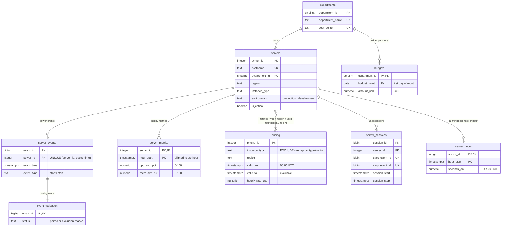

# Data model and dictionary

All data is simulated. Source tables are created in [`sql/01_schema.sql`](../sql/01_schema.sql); derived tables in [`sql/02_transform.sql`](../sql/02_transform.sql).

## Relationship diagram

`pricing` is not linked to `servers` by a foreign key: a server needs the tariff that is valid at each hour, which is a range lookup on `(instance_type, region)` plus time. Overlaps are impossible (exclusion constraint) and gaps are reported by `dq_pricing_gaps`.

## Source tables

| Table | Grain (one row per…) | Key | Notes |
|---|---|---|---|
| `departments` | business area | `department_id` | `cost_center` unique, format `CC-0000`. |
| `servers` | server | `server_id` | Department, region and type are constant during the period (simplification). `environment` ∈ production/development; `is_critical` marks servers excluded from shutdown scenarios. |
| `server_events` | power event | `event_id`; unique `(server_id, event_time)` | The unique key rejects exact duplicates and same-instant start/stop ties at load time. |
| `server_metrics` | server × UTC clock hour | `(server_id, hour_start)` | Average CPU and memory over the part of that hour in which the server ran. A missing row = not observed (unknown), never 0 %. |
| `pricing` | tariff version | `pricing_id`; exclusion on `(instance_type, region, [valid_from, valid_to))` | Fictitious USD per running hour. Changes take effect at 00:00 UTC (check constraint). |
| `budgets` | department × month | `(department_id, budget_month)` | `amount_usd = 0` is an explicit zero budget; a missing row means no budget defined. |
| `analysis_config` | single row | `config_id` (always `TRUE`) | Analysis period and the parameters of analyses 4 and 6. |

## Derived tables and views

| Object | Grain | Built from | Purpose |
|---|---|---|---|
| `event_validation` | event | `server_events` + `LAG`/`LEAD` | `paired` or one explicit exclusion reason. |
| `server_sessions` | valid session | paired events | One start with its immediately following stop. |
| `server_hours` | server × UTC hour | sessions clipped to the period | Running seconds per hour; base grain for cost, metrics and schedules. |
| `v_hourly_cost` | server × UTC hour | `server_hours` + `servers` + `pricing` | Cost model: `seconds_on / 3600 × hourly_rate_usd`. |
| `dq_*` views | various | all of the above | Event status, pricing gaps, unpriced hours, coverage counts. |
| `a1`–`a6` views | see each file | `sql/analysis/` | The six analyses. |
| `a4_low_utilization` | server | `server_hours`, `server_metrics`, `v_hourly_cost` | Bin counts (`active_hour_bins`, `observed_hour_bins`) are kept apart from durations (`running_seconds`, `observed_seconds`, `observed_running_hours`). `metric_coverage` = observed / running seconds. Full definitions: [methodology](methodology.md#units-in-analysis-4). |

## Column types

- Instants: `TIMESTAMPTZ`, always interpreted in UTC (`timezone` is set to UTC on the database and in every script).
- Money: `NUMERIC` (exact). Rates keep 4 decimals, budgets 2; intermediate costs keep full precision and are rounded only in exported CSV files.
- Percentages: `NUMERIC(5,2)` with `CHECK` 0–100.
